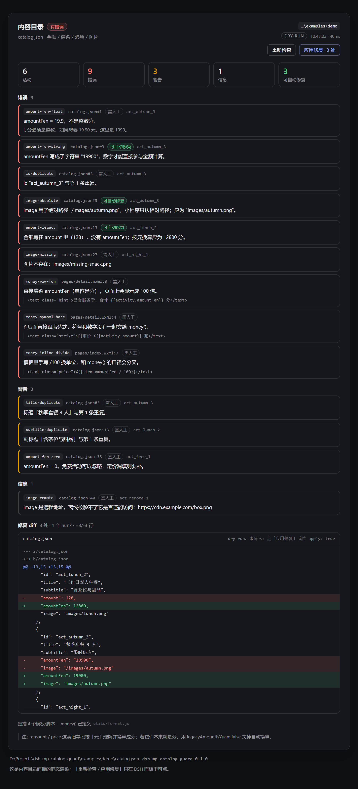

# dsh-mp-catalog-guard

[](https://github.com/dingchenhui0618-arch/dsh-mp-catalog-guard/actions/workflows/ci.yml)
[](LICENSE)

**微信小程序内容目录的守卫**：一个 DSH 插件 + 一个同源的命令行工具，检查 `catalog.json` 里的金额是不是整数分、页面上的价格是不是都走了 `money()`、必填字段/重复文案/图片路径有没有问题，输出一份问题清单和一份**可直接应用**的 unified diff。默认 dry-run，不写文件。

> 一句话：让「浮点金额、手写 `/100`、漏了 `image`」在发版前变成一条带行号的报错，而不是上线后变成客诉。

> 用着还行的话，点个 ⭐ 就够了——插件市场的「搜插件」按 GitHub star 排序，star 是这个插件能被人翻到的唯一杠杆。



浅色主题见 [docs/screenshot-2.png](docs/screenshot-2.png)：同一份报告、同一套样式，配色全部走 DSH 主题 token。

---

## 为什么需要它

小程序活动页最常见的三种金额事故，都不是「代码写得不够优雅」，而是**钱算错了**：

| 事故 | 现象 | 这个工具怎么拦 |
| --- | --- | --- |
| 金额存成浮点 | `"amountFen": 19.9`，`19.9 * 2` 出 `39.800000000000004` | `amount-fen-float` 报错，并给出「这里是 1990」的修法 |
| 页面里手写单位换算 | `¥{{item.amountFen / 100}}`，和 `money()` 的口径悄悄分叉 | `money-inline-divide` / `money-symbol-bare` / `money-tofixed` 逐行报告 |
| 字段或图片漏了 | 某条活动没 `image`，或图路径写成了 `/images/a.png`（小程序只认相对路径） | `field-missing` / `image-missing` / `image-absolute` |

这些问题靠 review 很难稳定拦住：它们分散在 JSON 和 wxml 里，而且「看起来都对」。所以这里把它们写成 29 条带严重级的规则。

## 它到底检查什么

29 条规则，分五组（完整定义在 [`src/rules.js`](src/rules.js)）：

**目录本身**（读不到 / 不是 JSON / 结构不对 / 空目录 / 条目不是对象）

**必填与唯一性**：`field-missing`（默认 `id`/`title`/`amountFen`/`image`）、`id-duplicate`（错误）、`title-duplicate`、`subtitle-duplicate`（告警，且忽略规范化后不足 6 字的副标题——「限时」重复不该刷屏）

**金额**：

- `amount-fen-float` 拒绝任何非整数 `amountFen`
- `amount-fen-string`（`"19900"`，可自动修复）、`amount-fen-negative`、`amount-fen-zero`（告警）、`amount-fen-suspicious`（≥ 1000 万分，通常是元分写混了）
- `amount-legacy`：还在用 `amount`/`price`/`fee`/`cost` 存金额，按「元」换算成 `amountFen`（**这是假设**，见下方「已知边界」）
- `amount-imprecise`（超过两位小数，拒绝四舍五入成价格）、`amount-unreadable`、`amount-missing`、`amount-duplicate-field`（新旧字段并存）

**渲染**（扫 `pages/**`、`components/**`、`templates/**` 的 wxml + js）：

- `money-inline-divide`：`/ 100` 手写换算
- `money-raw-fen`：直接把分渲染出来（页面会显示成 100 倍）
- `money-raw-amount`：直接渲染旧金额字段
- `money-symbol-bare`：`¥` 后面直接跟表达式
- `money-tofixed`：`toFixed(2)` 拼价格
- `money-helper-missing`：全项目找不到 `money()` 定义

**图片**：`image-missing`、`image-absolute`（可自动修复）、`image-outside`（`..` 跑到项目外）、`image-remote`（远程地址只能提示，离线校验不了——这是**信息**，不是错误）

## 三种用法

### 1. 作为 DSH 工具

插件向会话注册 `mp_catalog_guard`：

```json
{ "projectDir": ".", "apply": false }
```

返回完整报告对象（`counts` / `issues` / `fixes.diff`），并渲染成一段可读文本。适合让 agent 在改完活动、调价或发版前自己跑一次。

### 2. 作为对话面板

`内容目录` 面板（`conversation.view` 槽位，order 32）显示同一份报告：结论徽标、五个统计卡、按严重级分组的问题行（规则 id、`文件:行号`、条目 id、`需人工` / `可自动修复` 标签、修法提示），以及带颜色的 diff。面板上有 `重新检查` / `应用修复` 两个按钮，直接调 host 的 `/state` `/rescan` `/apply`。

面板轮询 host 的 `/state`，**渲染的是 host 生成的 HTML**——与下面「HTML 报告」和截图共用同一个渲染函数（[`src/panel-html.js`](src/panel-html.js)），所以截图里的东西不会和面板里的漂移。

### 3. 作为命令行

```bash
node bin/catalog-guard.mjs examples/demo          # 人读的摘要 + diff
node bin/catalog-guard.mjs . --json               # 机器读的完整报告
node bin/catalog-guard.mjs . --apply              # 把可自动修复的项写回
node bin/catalog-guard.mjs . --report out.html    # 另存一份自包含 HTML 报告
node bin/catalog-guard.mjs . --no-render --quiet  # 只看目录，只要一行结论
```

退出码：`0` 干净、`1` 有问题（或写回失败）、`2` 用法错误。可以直接放进 CI 的 `run:` 里。

## 自动修复的边界

只有三条规则可自动修复，因为它们**只有唯一一种正确写法**：

| 修复 | 输入 → 输出 |
| --- | --- |
| `amount-legacy` | `"amount": 128` → `"amountFen": 12800`（键位置不变，先删旧键再插新键会打乱可读性） |
| `amount-fen-string` | `"amountFen": "19900"` → `"amountFen": 19900` |
| `image-absolute` | `"/images/a.png"` → `"images/a.png"`（仅当相对路径确实存在） |

其余规则**一律不猜**：`19.9` 到底是 19.9 元还是 199 分只有作者知道，所以报告里只写「这里是 1990，请人工确认」。

写回时保持原文件的格式：缩进（2 空格 / 4 空格 / Tab）、行尾（LF / CRLF）、结尾换行都沿用原文件；被压缩成一行的 `catalog.json` 会被重新缩进，报告里会明说这一点。diff 用 LF 归一后比较，所以 Windows 检出不会出现整文件 diff。

`apply` 之后**重新检查写回后的文件**，报告里列的是「还剩什么问题」，而不是刚被修掉的那些。

## 配置

插件 config（`cordis.patch.yml` 的 `config`）：

| 键 | 默认 | 说明 |
| --- | --- | --- |
| `projectDir` | 会话工作目录 | 小程序根目录 |
| `catalogFile` | `catalog.json` | 目录文件，相对 `projectDir` |
| `requiredFields` | `id,title,amountFen,image` | 必填字段 |
| `imageBase` | 空 | 图片根目录（图片集中放 `static/` 时用） |
| `scanPatterns` | `pages/components/templates/utils` | 模板扫描 glob |
| `render` | `true` | 是否扫 wxml/js |
| `legacyAmountIsYuan` | `true` | 旧金额字段按元解释并 ×100 |
| `minDuplicateLength` | `6` | 副标题重复判定的最短长度 |
| `dataDir` | `$DSH_HOME/mp-catalog-guard` | 面板状态与历史落盘目录 |

## 目录结构

```
src/
  rules.js         规则表：id / 严重级 / 文案，严重级只在这里定义一次
  catalog.js       解析、金额契约、重复文案、条目行号定位
  assets.js        图片路径（相对 / 绝对 / 远程 / 越界）
  render.js        wxml/js 扫描与 money() 检测
  fix.js           修复计划 + 序列化 + LCS unified diff
  check.js         整个检查：读 → 解析 → 三组检查 → 计划 → 可选写回
  report.js        报告组装 + 文本摘要
  panel-html.js    面板 / HTML 报告 / 截图共用的唯一 markup 源
  client-css.cjs   .mc-* 样式（主题 token + color-mix，无硬编码配色）
  io.js            node:fs 与内存两套 IO（测试用内存）
  host.js          工具 + HTTP 路由 + 状态落盘
  client.cjs       面板壳、轮询、两个按钮（CommonJS，构建时包成 ModuleLoader）
  index.js         插件出口
  cli.js           命令行
scripts/
  build.mjs        零依赖构建：拷模块、内联 CSS、包装 client、校验产物
  wrap-client.mjs  window.__ModuleLoader__.load 包装
  demo.mjs         生成 examples/demo 并跑一遍
  screenshot.mjs   CDP 全页截图
test/              180 个测试（node --test）
```

构建是**零依赖**的：`npm run build` 只是拷文件 + 拼 CSS + 做一次 `new Function()` 语法校验，没有 webpack/rollup。`lib/` 是产物，CI 会校验它与 `src/` 同步。

## 测试

```bash
node --test            # 180 个测试，全部通过
```

覆盖：解析的六种输入形状、金额的十种状态、重复文案阈值、行号定位的歧义处理、glob 匹配与目录遍历（跳过 `node_modules`/`dist`/`.git`）、diff 的上下文与多 hunk、序列化的缩进/行尾/结尾换行、dry-run 不写文件、apply 后重查、HTML 转义（`<script>` 不会注入）、面板两种模式、host 的工具契约与路由、状态落盘与损坏状态文件、卸载时释放工具与路由、client 的两个按钮与轮询、以及 CLI 的退出码。

## 和最初一句话相比，多了什么

最初的需求是「校验金额、渲染、必填、重复、图片，输出问题清单和修复 diff」。落地时多做了这些，因为不做的话工具会被绕过：

1. **扫 wxml/js 的渲染规则**——只查 JSON 拦不住 `/100` 和直接渲染 `amountFen`，而这两类才是线上显示错误的直接原因。
2. **独立的 CLI 与自包含 HTML 报告**——没有面板的机器、或想放进 CI 的仓库也能用。
3. **`money-helper-missing` 规则**——全项目没有 `money()` 时，其余渲染规则全是假阳性。
4. **副标题重复的最短长度阈值**——否则「限时」「含茶位」这类短标签会刷屏。
5. **apply 之后重查**——报告必须描述写回后的真实状态，否则 CI 里 `--apply` 永远是红的。
6. **diff 保留原文件格式**——否则一次 `--apply` 会把整个文件重排，review 里全是噪音。

## 参考了什么、哪里不同

- 工程骨架（零依赖 `scripts/build.mjs`、`window.__ModuleLoader__` 的 client 包装、`cordis.patch.yml`、`engines.dsh` 声明）参考了同机的 **dsh-warden**；面板「HTML 由 host 生成、client 只做壳」的做法参考了 **dsh-vision-diff**；状态落盘 + 统计卡的做法参考了 **dsh-cost-ledger**。
- **没有 fork、没有克隆任何人的仓库、没有整段复制代码**：三条自动修复、29 条规则、金额契约、LCS diff、面板样式都是为这个任务独立写的。
- 与它们的不同：这个插件**不调用模型、不联网**——纯静态检查，输入输出都是本地文件；它的核心交付是「一份能直接 `patch -p1` 的 diff」，面板只是同一份结果的另一种呈现。

## 已知边界（诚实清单）

- **`amount`/`price` 按「元」解释是约定，不是事实**。如果你的旧字段本来就是分，用 `legacyAmountIsYuan: false` 关掉换算，否则 `128` 会被写成 `12800`。
- **远程图片只提示、不校验**：离线环境没法确认 CDN 上那张图还在不在。`image-remote` 是信息级，不影响退出码。
- **只认常见目录结构**：默认扫 `pages/**`、`components/**`、`templates/**`、`utils/**`；自定义结构用 `scanPatterns`。
- **不解析 `app.json` 的页面清单**，也不做 WXML 语法分析——它只按行找金额模式，命中一行最多报一条。
- **截图来自同一渲染函数的静态页面，不是在 DSH 里现场截的**：本次交付没有把插件装进用户正在使用的 profile（那需要重启宿主）。面板与 HTML 报告共用 `renderPanelHtml()`，所以视觉上一致；但「在真实会话里点按钮」这件事没有截图证据。
- **没有发布到 npm**：`package.json` 里没有可用的 `npx` 安装路径，请按 DSH 的插件安装方式指向本地目录或 GitHub 源。

## License

MIT © 2026 dingchenhui0618-arch
